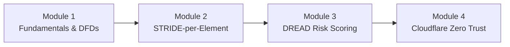

# 🛡️ Campus Threat Modeling & Zero Trust Workshop Series
### *A 4-Part Applied Security Engineering Workshop: Threat Modeling, Network Fundamentals & Cloudflare Zero Trust*

[](LICENSE)
[](#curriculum)
[](#dread)
[](#zero-trust)
[](app/workshop_portal.py)

---

## 📌 Executive Summary

The **Campus Threat Modeling Workshop Series** is an applied cybersecurity educational curriculum and engineering toolkit designed to train students and developers in modern proactive defense. The 4-part series bridges software design security, network protocols, and enterprise edge security by combining:
1. **System Decomposition & Data Flow Diagramming (DFD)**.
2. **STRIDE-per-Element Threat Enumeration** using automated modeling engines.
3. **DREAD Quantitative Risk Prioritization** and engineering mitigation planning.
4. **Cloudflare Zero Trust Architecture Implementation** (Cloudflare Access, Tunnels, and Gateway).

---

## 📚 4-Part Workshop Curriculum



### [Module 1: Threat Modeling Fundamentals & DFDs](curriculum/module-1-fundamentals/README.md)
- Core philosophy: The 4 fundamental questions of threat modeling.
- Data Flow Diagramming: External Entities, Processes, Data Stores, Data Flows.
- Defining Trust Boundaries across modern cloud/campus hybrid networks.

### [Module 2: STRIDE Deep-Dive & Attack Trees](curriculum/module-2-stride-deep-dive/README.md)
- Deep dive into the 6 STRIDE categories: Spoofing, Tampering, Repudiation, Information Disclosure, Denial of Service, Elevation of Privilege.
- The **STRIDE-per-Element Matrix**: Matching threats precisely to architectural component types.
- Hands-on threat hunting on a distributed campus gradebook microservice.

### [Module 3: Quantitative Risk Scoring (DREAD)](curriculum/module-3-dread-risk-eval/README.md)
- Mathematical risk formulation: Damage, Reproducibility, Exploitability, Affected Users, Discoverability.
- Calculating severity brackets: Critical (8-10), High (6-7.9), Medium (4-5.9), Low (1-3.9).
- Translating theoretical threats into engineering mitigation backlogs.

### [Module 4: Cloudflare's Zero Trust Stack & Defenses](curriculum/module-4-zero-trust-stack/README.md)
- Replacing legacy Castle-and-Moat VPN architectures with **ZTNA (Zero Trust Network Access)**.
- Inbound attack surface reduction via **Cloudflare Tunnels (`cloudflared`)** (closing public inbound ports).
- Identity-aware access rules with IdP integration (SSO + MFA) and device posture checks.
- Egress network inspection with Cloudflare Gateway and WARP.

---

## 🛠️ Automated Threat Modeler Engine (`tools/`)

The repository includes a Python-powered automated threat modeling engine:
- `tools/model.py`: Pydantic data schemas for components, data flows, and DREAD scores.
- `tools/stride_engine.py`: Automated STRIDE threat generator implementing Microsoft Threat Modeling rules.
- `tools/dread_calculator.py`: Risk prioritizer and severity aggregator.
- `tools/report_exporter.py`: Automated exporter generating audit-ready Markdown and JSON threat reports.

---

## 🚀 Quickstart & Setup

### 1. Installation
```bash
git clone https://github.com/sandhupritpal/campus-threat-modeling-series.git
cd campus-threat-modeling-series
pip install -r requirements.txt
```

### 2. Launch the Interactive Workshop Portal
Experience the interactive curriculum, DFD visualizer, and automated threat modeler:
```bash
streamlit run app/workshop_portal.py
```

### 3. Run Automated Threat Modeling CLI
Generate an audit report for the campus portal architecture:
```bash
python -c "
from tools.model import SystemComponent; import json
from tools.stride_engine import enumerate_stride_threats
from tools.dread_calculator import score_threat, rank_threats_by_risk
from tools.report_exporter import ThreatReportExporter
with open('labs/lab1-campus-portal-dfd/architecture.json') as f: data = json.load(f)
comps = [SystemComponent(**c) for c in data['components']]
threats = []
for c in comps: threats.extend(enumerate_stride_threats(c))
for t in threats: score_threat(t, 8, 7, 7, 8, 7)
ThreatReportExporter.save_reports(data['system_name'], comps, rank_threats_by_risk(threats))
print('Report generated in reports/threat_model_report.md')
"
```

### 4. Run Test Suite
```bash
pytest tests/ -v
```

---

## 📂 Repository Structure

```
campus-threat-modeling-series/
├── README.md                      # Curriculum overview & documentation
├── requirements.txt               # Dependencies
├── pyproject.toml / pytest.ini    # Python package configuration
├── LICENSE                        # MIT License
├── upload-to-github.bat           # 1-Click zero-error GitHub uploader
├── curriculum/                    # 4-Part Workshop Curriculum
│   ├── module-1-fundamentals/     # Threat modeling basics & DFD syntax
│   ├── module-2-stride-deep-dive/ # STRIDE-per-element & attack trees
│   ├── module-3-dread-risk-eval/  # Quantitative risk ranking (DREAD)
│   └── module-4-zero-trust-stack/ # Cloudflare Access, Tunnels, Gateway
├── labs/                          # Hands-On Exercises & Configurations
│   ├── lab1-campus-portal-dfd/    # Sample target architecture DFD
│   ├── lab4-cloudflare-zerotrust/ # Cloudflare Zero Trust rules simulation
├── tools/                         # Automated Threat Modeling Engine
│   ├── model.py                   # Data schemas (STRIDE, DREAD, Components)
│   ├── stride_engine.py           # STRIDE enumeration rules
│   ├── dread_calculator.py        # DREAD scoring calculator
│   └── report_exporter.py         # Markdown/JSON audit generator
├── app/
│   └── workshop_portal.py         # Interactive Streamlit workshop app
└── tests/
    ├── test_stride_engine.py
    └── test_dread_calculator.py
```

---

## 📜 License
This project is licensed under the MIT License — see the [LICENSE](LICENSE) file for details.
