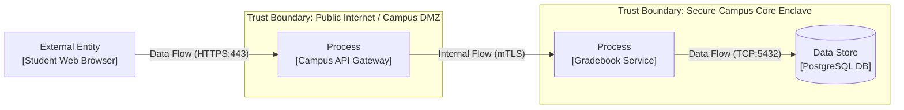

# Module 1: Threat Modeling Fundamentals & DFD Architecture

## 🎯 Learning Objectives
- Understand the core philosophy of Threat Modeling: *"You can't secure what you don't understand."*
- Master the 4 Fundamental Threat Modeling Questions:
  1. What are we working on?
  2. What can go wrong?
  3. What are we going to do about it?
  4. Did we do a good enough job?
- Learn Data Flow Diagramming (DFD) element notation and Trust Boundary placement.

---

## 🏛️ System Decomposition & DFD Elements

When modeling an application, we decompose it into 4 primary building blocks:

### Element Types:
1. **External Entities (Rectangles)**: Actors outside our direct control (e.g. Student Browser, Payment Gateway, Registrar Admin).
2. **Processes (Circles/Boxes)**: Code executing computation (e.g. Node.js backend, microservices, Lambda functions).
3. **Data Stores (Parallel Lines/Cylinders)**: Persistent repositories (e.g. PostgreSQL, Redis, S3 bucket).
4. **Data Flows (Arrows)**: Data movement channels (e.g. HTTPS JSON payload, SQL connection, Kafka event).
5. **Trust Boundaries (Dotted Lines)**: Transitions where trust levels change (e.g. Public Internet $\rightarrow$ Cloud VPC, Container boundary).

---

## 💻 Hands-on Exercise: Lab 1
Review `labs/lab1-campus-portal-dfd/architecture.json` and draw the trust boundary intersections for the Student Enrollment Portal.
