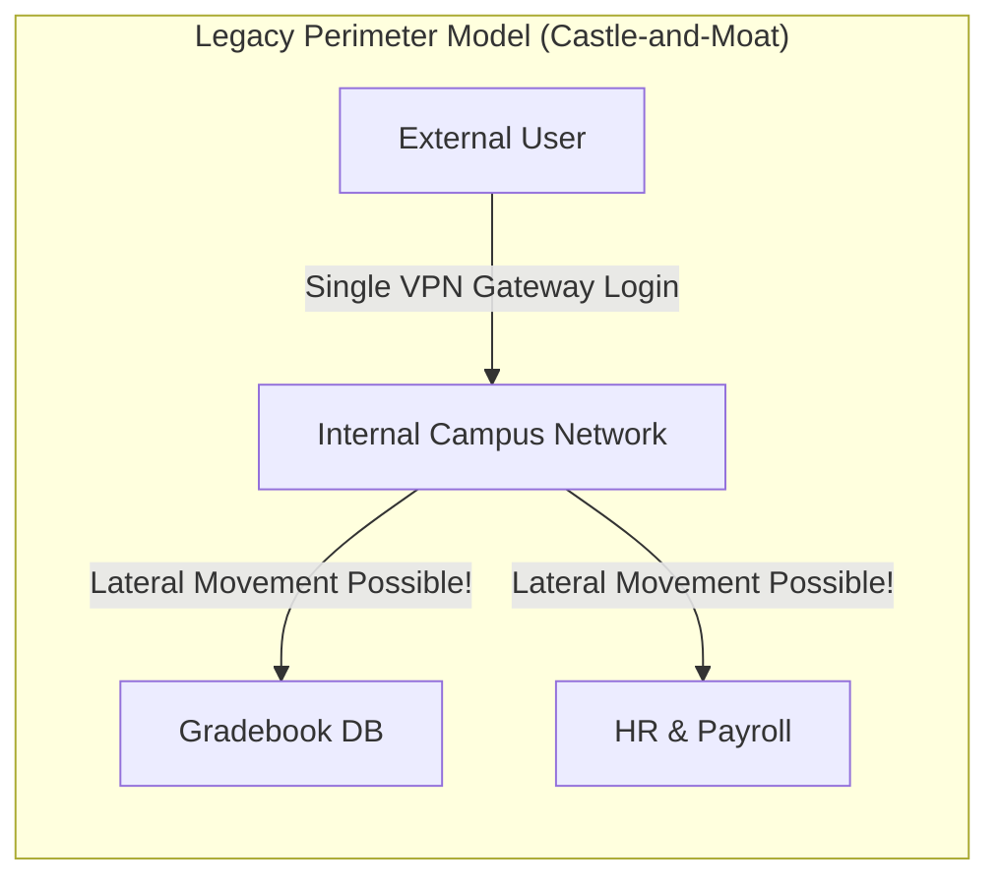

# Module 4: Cloudflare's Zero Trust Stack & Defensive Mitigations

## 🎯 Learning Objectives
- Understand modern **Zero Trust Network Access (ZTNA)** principles: *"Never Trust, Always Verify"*.
- Contrast legacy perimeter VPN security with identity-aware Zero Trust proxies.
- Architect defense layers using Cloudflare Access, Tunnels (`cloudflared`), Gateway, and WARP.

---

## 🛡️ Zero Trust Core Principles



```mermaid
flowchart LR
    subgraph ZeroTrust ["Cloudflare Zero Trust Architecture"]
        E["Student / Faculty Device"] -->|1. Device Posture & WARP| F["Cloudflare Global Anycast Edge"]
        F -->|2. IdP Authentication (Okta/Azure AD)| F
        F -->|3. Contextual Rule Verification| G["Encrypted Outbound Tunnel (cloudflared)"]
        G --> H["Protected Campus Microservice"]
    end
```

### 1. Zero Trust Principles:
- **Assume Breach**: Operate as though an adversary is already inside the campus Wi-Fi.
- **Verify Explicitly**: Authenticate identity, device posture, location, and MFA on *every single request*, not just at session login.
- **Least-Privilege Access**: Limit access strictly to specific authorized applications, eliminating lateral movement.

### 2. Cloudflare Zero Trust Components:
- **Cloudflare Access (ZTNA)**: Replaces legacy VPNs. Acts as an identity-aware reverse proxy in front of internal web apps and SSH/RDP servers.
- **Cloudflare Tunnel (`cloudflared`)**: Creates a secure, outbound-only connection from the campus server to Cloudflare's edge. **No public IP address or open inbound firewall ports (Port 80/443 closed!)**.
- **Cloudflare Gateway & WARP Client**: Inspects egress DNS, HTTP, and network traffic from managed campus endpoints, enforcing malware filtering and DLP policies.
- **Device Posture Checks**: Validates endpoint health (OS version, disk encryption, antivirus running) before granting access.
